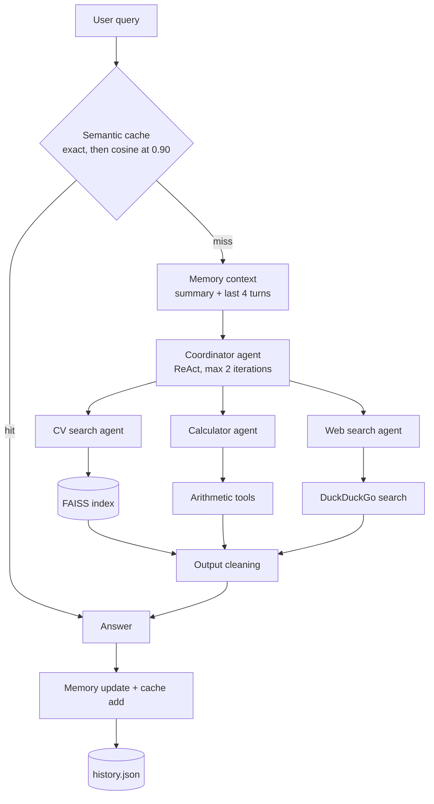

# CV Search Multi-Agent System

A coordinator agent routes questions to three specialist agents (CV search over 495 CVs, a calculator, web search). Everything runs on a local 4-bit Mistral-7B-Instruct model, with end-to-end MLflow tracing on Databricks.

**Status:** working prototype, developed and run on Kaggle. There is no quantitative evaluation yet (see [Evaluation](#evaluation)).

## What this demonstrates

- **Multi-agent orchestration.** A coordinator ReAct agent delegates to specialist agents that are exposed to it as tools.
- **RAG.** 495 CV documents split into 2,575 chunks, embedded with all-MiniLM-L6-v2, indexed in FAISS, retrieved with source files.
- **Making a small model usable.** Stop strings, a custom output parser and output cleaning address specific failures of a 7B model in ReAct loops.
- **Memory and caching.** Summary-buffer conversation memory and a two-layer semantic answer cache, both persisted to JSON.
- **Observability.** MLflow traces of agent, tool, retriever and LLM calls on Databricks, tagged by whether the answer came from the cache or the agent.

## Architecture



MLflow tracing wraps the whole path, and one local Mistral model drives every agent and the summariser. A text version and the module map are in [docs/architecture.md](docs/architecture.md).

## Where each skill lives

| Skill | Module |
|---|---|
| Agent orchestration, tool calling | [`agents.py`](src/cv_agent/agents.py), [`tools.py`](src/cv_agent/tools.py) |
| RAG | [`rag.py`](src/cv_agent/rag.py) |
| Reliability engineering for a small local model | [`llm.py`](src/cv_agent/llm.py), [`grounded_parser.py`](src/cv_agent/grounded_parser.py), [`output_cleaning.py`](src/cv_agent/output_cleaning.py) |
| Conversation memory | [`memory.py`](src/cv_agent/memory.py), [`summarizer.py`](src/cv_agent/summarizer.py) |
| Semantic caching | [`cache.py`](src/cv_agent/cache.py) |
| Persistence | [`persistence.py`](src/cv_agent/persistence.py) |
| LLM observability | [`tracing.py`](src/cv_agent/tracing.py), [`assistant.py`](src/cv_agent/assistant.py) |

## Repository layout

```
cv-search-agent/
├── src/cv_agent/          the package (one responsibility per module)
├── tests/                 unit tests for the logic that does not need a GPU
├── scripts/
│   ├── run_demo.py        fixed list of queries with timing
│   └── sanity_checks.py   raw generation, stop strings, retrieval
├── notebooks/
│   └── cv_agent_walkthrough.ipynb   the original single-file notebook, with captured outputs
├── docs/
│   ├── architecture.md
│   └── design_decisions.md
├── pyproject.toml
└── requirements.txt
```

## Quick start

Developed on Kaggle with a GPU. I have not run it anywhere else.

1. Create a Kaggle notebook with a GPU accelerator and Internet on.
2. Attach a Mistral-7B-Instruct 4-bit model dataset and the CV JSON dataset (each file has a `"text"` field).
3. Add Kaggle secrets `DATABRICKS_HOST` and `DATABRICKS_TOKEN`.
4. In a notebook cell:

```python
!git clone https://github.com/<your-github-username>/cv-search-agent
!pip install -q -e cv-search-agent

import os
os.environ["MLFLOW_EXPERIMENT"] = "/Users/<your-email>/my-ai-agent"

from cv_agent.bootstrap import build_assistant

assistant = build_assistant()
print(assistant.ask("Who has experience with Python and Docker?"))
```

Other entry points: `python -m cv_agent` (interactive chat) and `python scripts/run_demo.py` (scripted queries). If no Databricks credentials are found, tracing is skipped.

### Configuration

| Variable | Purpose | Default |
|---|---|---|
| `CV_AGENT_MODEL_PATH` | Folder with the Mistral weights | First folder under `/kaggle/input` with "mistral" in its path |
| `CV_AGENT_DATA_DIR` | Folder with the CV `.json` files | `/kaggle/input` |
| `CV_AGENT_HISTORY_PATH` | Where `history.json` is written | `/kaggle/working/history.json` on Kaggle, else `./history.json` |
| `MLFLOW_EXPERIMENT` | Databricks experiment path | none, required when tracing |
| `DATABRICKS_HOST`, `DATABRICKS_TOKEN` | Databricks credentials | read from the environment, then from Kaggle secrets |

Tunable constants (chunk size, top-k, iteration caps, cache threshold) are in [`config.py`](src/cv_agent/config.py).

## Reliability engineering for a 7B model

The model is small, so the ReAct loop breaks in specific ways. Each one was diagnosed and has a targeted fix:

- It opens a fake `Question:` or `Thought:` turn after answering -> `stop_strings`, a 200-token cap and output cleaning.
- It guesses a `Final Answer` in the same turn as an `Action`, and the stock parser's error then derails the next step -> `GroundedReActOutputParser` keeps the Action.
- A long CV dump can fill the context -> clipped answers and batched summarisation.
- A cache would return stale answers for "latest" questions -> time-sensitive words bypass it.

The full problem/fix table is in [docs/design_decisions.md](docs/design_decisions.md).

## Results so far

Outputs captured from the Kaggle run (full outputs are in the [walkthrough notebook](notebooks/cv_agent_walkthrough.ipynb)):

| Query | Routed to | Returned |
|---|---|---|
| What is 25 multiplied by 4? | Calculator agent | `100` |
| What is the latest version of Python? | Web agent | The latest version of Python is 3.15.0. |

Cache threshold probe at 0.90 (cosine similarity of query pairs):

| Pair | Score | Fires |
|---|---|---|
| "What is 25 multiplied by 4?" / "what is 25 * 4" (same meaning) | 0.827 | No |
| "Who has experience with Python and Docker?" / "Which candidates know Python and Docker?" (same meaning) | 0.773 | No |
| "Who has experience with Python?" / "Who has experience with Java?" (different) | 0.528 | No |
| "Who has a Master's degree?" / "How many candidates are there?" (different) | 0.154 | No |

### Evaluation

[TODO: add measured result - retrieval hit rate, answer correctness and latency on a labelled question set]

[TODO: add MLflow trace screenshot - a cache-miss trace expanded to show coordinator, specialist and retriever/LLM spans]

## Known limitations

- No evaluation set, so retrieval quality, answer accuracy and latency are not measured.
- The 7B model limits ReAct reliability. The fixes reduce failures but do not remove them: in one captured run the query for Java skills returned unfilled `[Candidate 1, ...]` placeholders instead of names.
- Retrieval returns the top 3 chunks, so aggregate questions ("who has X and Y", counts) cannot be answered reliably.
- The calculator agent demonstrates orchestration and tool calling. It is not a production design.
- The 0.90 cache threshold is untuned; the probe above shows two paraphrase pairs below it.
- No query that needs two specialists is demonstrated.
- Web answers come from search snippets and do not cite sources.

## Tests

```
pip install pytest numpy
pytest
```

The tests cover the logic that does not need a GPU: output cleaning, the cache (exact, semantic, TTL, time-sensitive bypass, export/import), memory, persistence (round trip, corrupt file, model change), and the assistant's cache-versus-agent flow with a fake coordinator. Tests that need LangChain or MLflow (`test_grounded_parser.py`, `test_tools.py`, `test_assistant.py`) skip themselves when those packages are missing. The model itself, retrieval quality and agent behaviour are not covered by automated tests.

## Roadmap

- Labelled evaluation set (20 to 30 questions) for retrieval and answer correctness.
- Tune the cache threshold on labelled paraphrase pairs.
- A query that exercises two specialists in one request.
