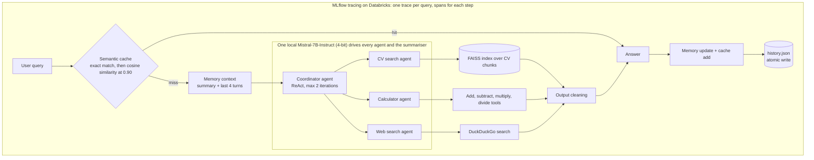

# Architecture



Text version:

```
user query
    |
    v
[Semantic cache: exact match, then cosine >= 0.90] --hit--+
    | miss                                                 |
    v                                                      |
[Memory context: summary + last 4 turns]                   |
    |                                                      |
    v                                                      |
[Coordinator agent: ReAct, max 2 iterations]               |
    |                 |                    |               |
    v                 v                    v               |
[CV search agent] [Calculator agent] [Web search agent]    |
    |                 |                    |               |
 FAISS index      add/sub/mul/div       DuckDuckGo         |
    |                 |                    |               |
    +-----------------+--------------------+               |
                      v                                    |
               [Output cleaning]                           |
                      v                                    v
                   [Answer] <------------------------------+
                      v
        [Memory update + cache add]
                      v
        [history.json, atomic write]
```

## Module map

| Module | Responsibility | Heavy deps |
|---|---|---|
| `config.py` | Constants, environment variable names | none |
| `llm.py` | Find and load the model, raw generation, LangChain wrapper with stop strings | torch, transformers |
| `rag.py` | Load CV JSON, chunk, embed, FAISS index, `search_cvs` | LangChain, FAISS |
| `output_cleaning.py` | Trim invented turns | none |
| `grounded_parser.py` | ReAct parser that keeps the Action | langchain-classic |
| `prompts.py` | All prompt templates | none |
| `tools.py` | CV search, four arithmetic tools, web search | LangChain |
| `agents.py` | Specialist agents, agent-as-tool wrappers, coordinator | langchain-classic |
| `memory.py` | Summary-buffer memory (summariser is injected) | none |
| `summarizer.py` | Summariser that calls the model directly | torch |
| `cache.py` | Two-layer semantic cache | numpy |
| `persistence.py` | Atomic JSON save, tolerant load | none |
| `assistant.py` | `CVSearchAssistant.ask`: the traced entry point | mlflow |
| `bootstrap.py` | Builds everything and returns the assistant | all |
| `tracing.py` | MLflow and Databricks setup | mlflow |
| `cli.py` | Interactive chat loop | all |

Modules with no heavy dependencies are the ones covered by the unit tests.
